# Nórdico

**English** · [Português (Brasil)](README.pt-BR.md)


A minimal, OEM-grade launcher for aftermarket Android car head units, built with Kotlin and
Jetpack Compose.

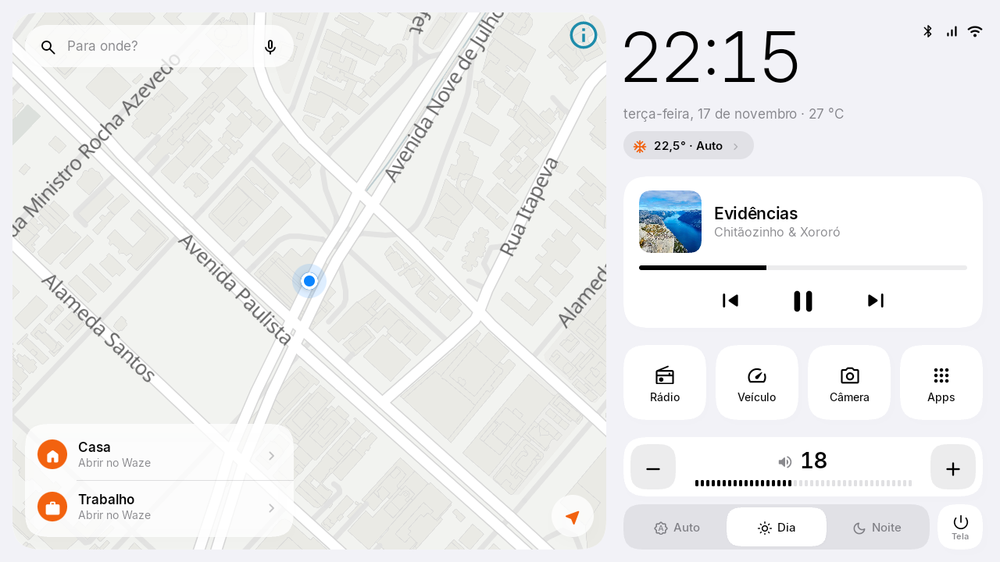

## Why this exists

Most aftermarket Android head units ship with the same generic interface: stock Android icons,
mismatched vendor apps, inconsistent fonts. They work, but they don't look or feel like they
belong in the car.

Nórdico started with one specific unit (a TorqueHammer VPL-1166: Unisoc UIS8581A, Android 14,
9" 1280×720 QLED) installed in a 2015 Honda Civic. The goal was an interface that feels like it
came from the carmaker: calm, legible at a glance, with one accent color, real content and
fluid animations. The visual direction mixes the map-first layout of Scandinavian car systems
with Apple-style minimalism.

**Nórdico does not replace the ROM.** It is a regular Android app that registers itself as the
home screen (launcher). Everything the vendor firmware provides keeps working underneath:
reverse camera, steering wheel controls, CarPlay/Android Auto, radio. It can be removed at any
time and needs no root.

## Screenshots

| Day | Night |
|---|---|
|  | 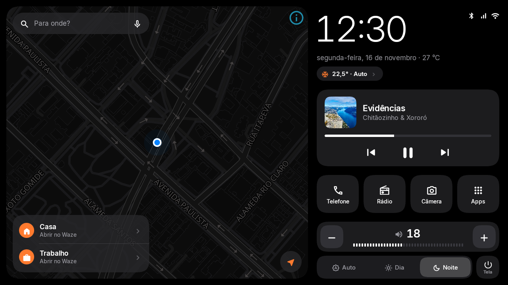 |
| 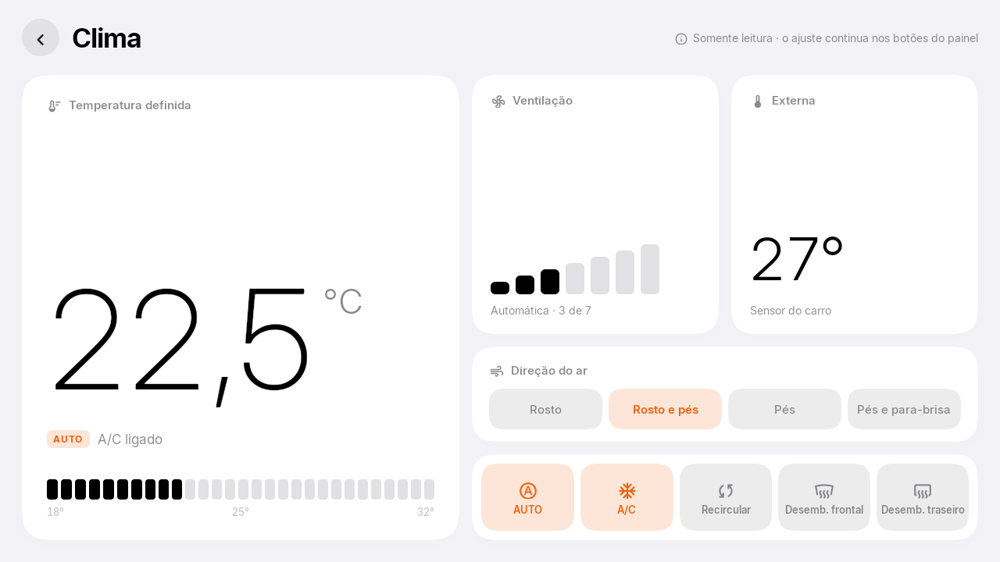 | 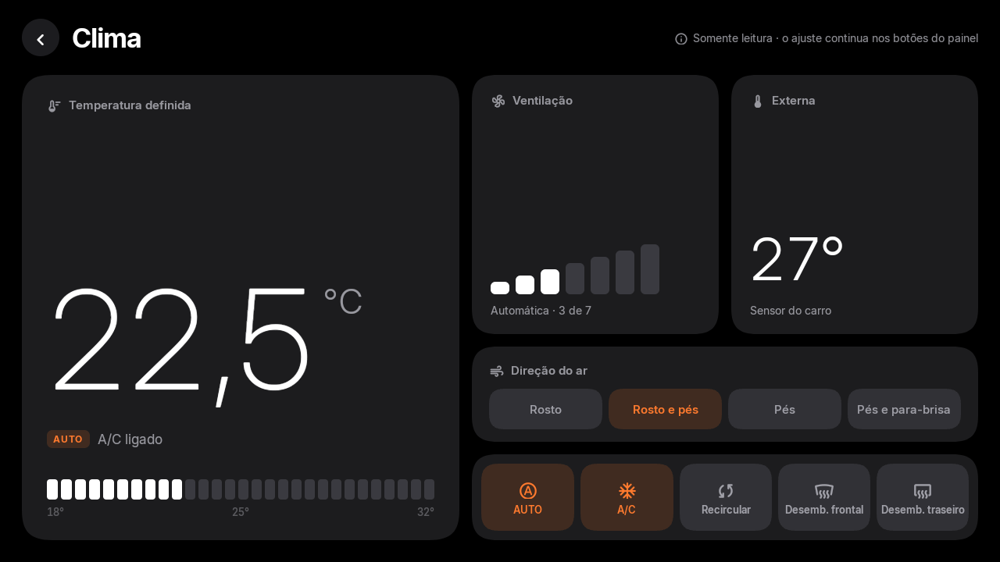 |

| Now playing | App drawer |
|---|---|
| 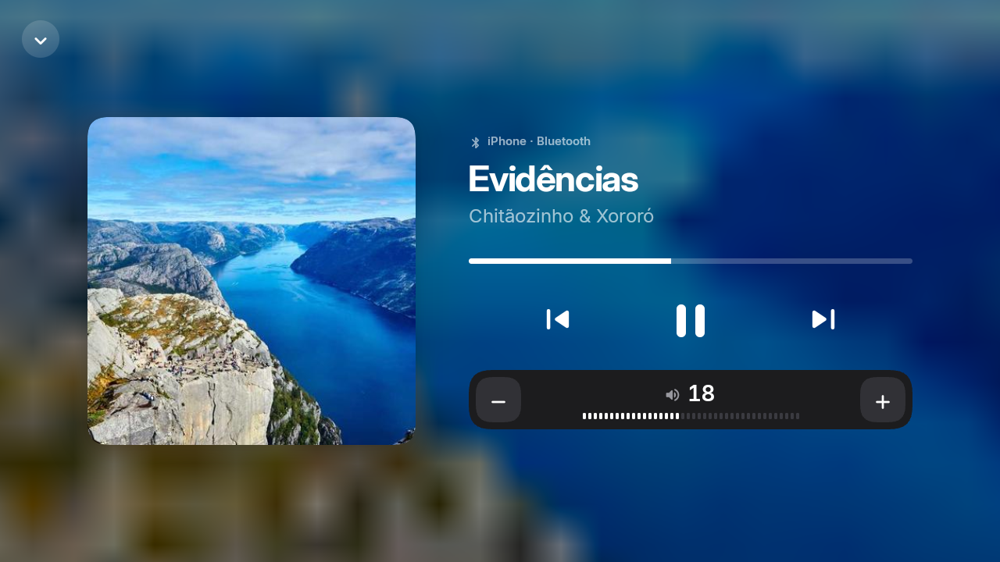 | 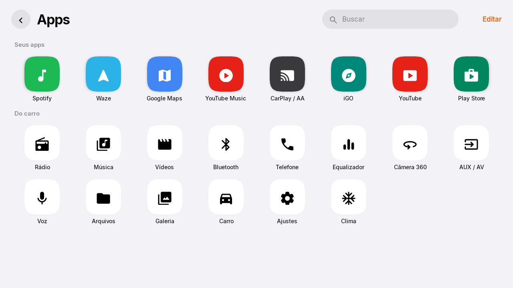 |
| 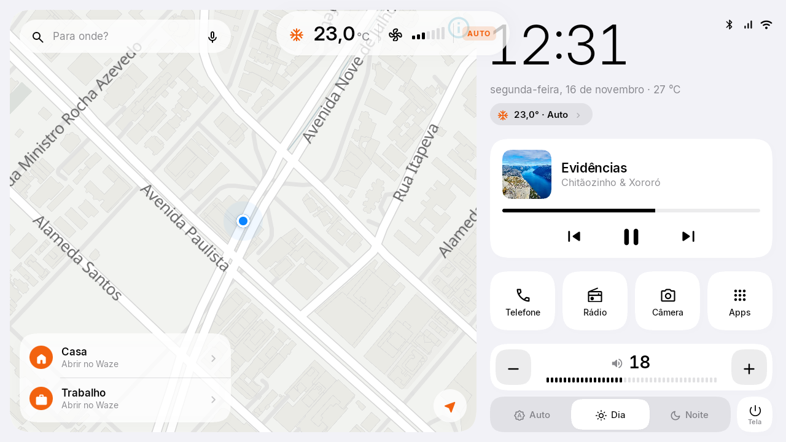 | 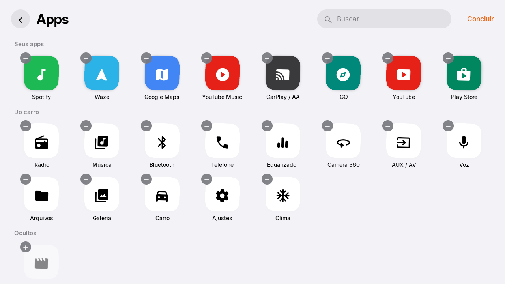 |

| Vehicle | Radio |
|---|---|
| 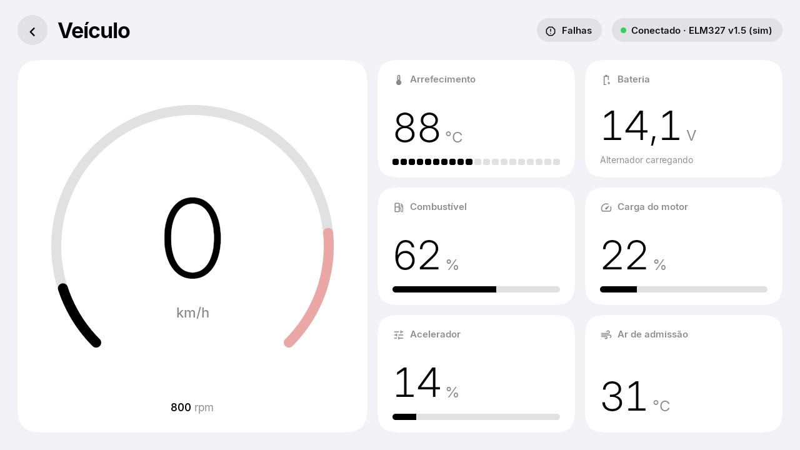 | 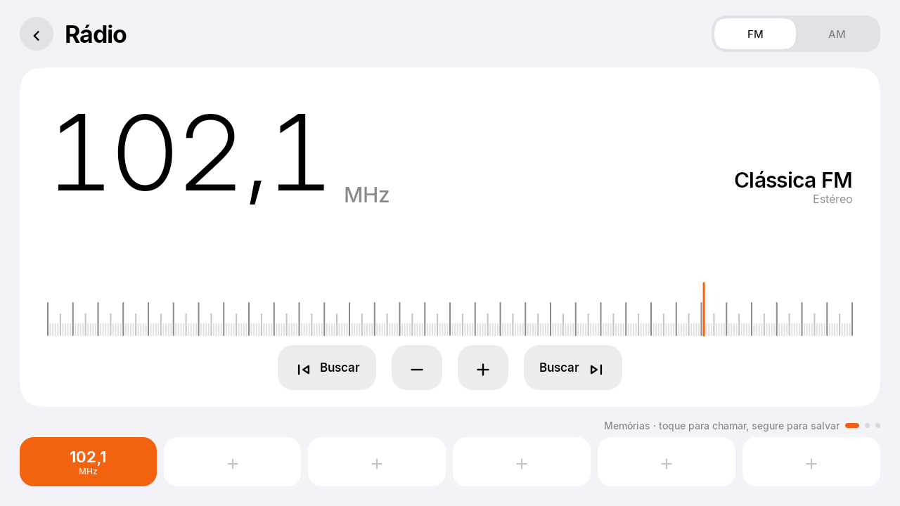 |
| 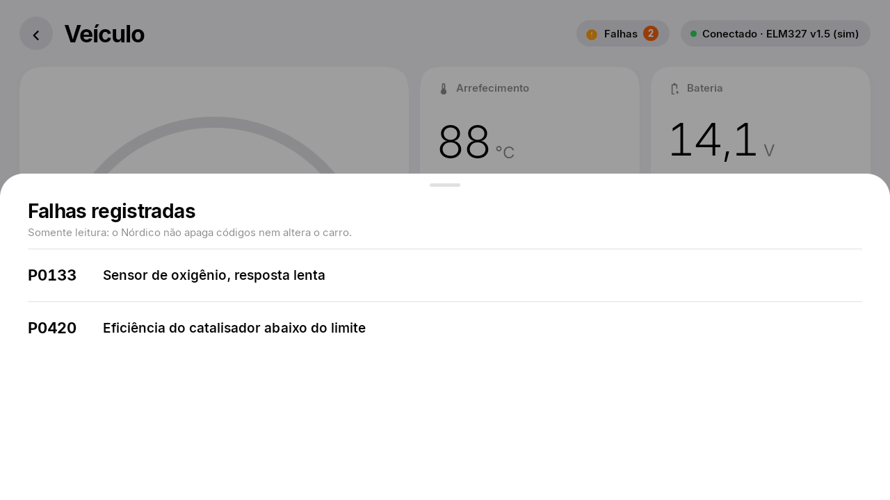 | 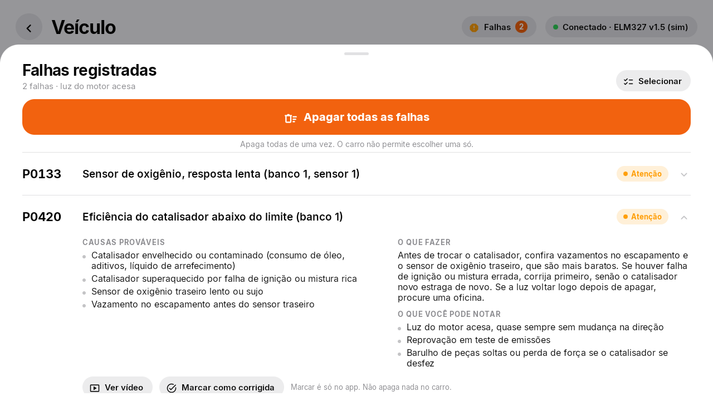 |
| 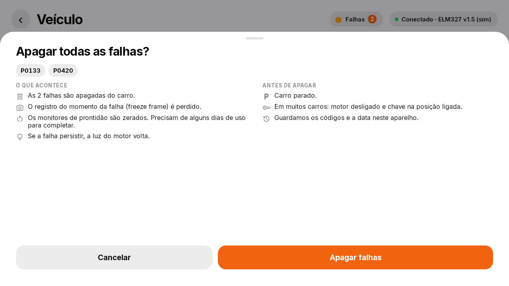 | |

The original HTML prototypes that defined the design live in
[`docs/prototipos/`](docs/prototipos) and open directly in a browser.

## Features

**Home**
- Live vector map (MapLibre + OpenFreeMap) with a location puck. Day and night styles follow the theme.
- "Where to?" opens your navigation app. Home/Work shortcuts open your saved Waze favorites.
- Large clock, date in Brazilian Portuguese, outside temperature and a climate status chip.
- Now-playing card for any app that publishes a media session (Spotify, Bluetooth audio, YouTube Music, browsers…).
- Volume panel with −/+ buttons (press and hold to repeat), a segmented level meter and tap-to-mute.
- Screen mode: Auto (follows the headlights when the car reports them, otherwise 18:00–06:00), Day or Night.
- Screen-off button that leaves only a dim clock.

**Vehicle (OBD-II)**
- Speed with a rotation arc, coolant, battery voltage, fuel, engine load, throttle and intake air, read from an ELM327 adapter over Bluetooth.
- Stored fault codes with a count badge. Each code has a title, severity, probable causes, what to do and a video link, from an offline catalog of ~9,600 codes (about 20 written in full in Portuguese, the rest with a title, growing in batches).
- **Clear codes**: "Clear all faults" sends the standard OBD-II clear command (mode 04). It is the only write the app ever makes, and it is guarded: only with the car stopped and connected, after a confirmation that explains the effects, never retried automatically, and reported as "cleared" only after reading the codes back.
- "Mark as fixed" (single or multiple) is a note kept in the app. It does not touch the car: the OBD-II standard cannot clear a single code, only all of them.
- Alerts for high coolant temperature and abnormal battery voltage, shown as a HUD on any screen. Tapping it opens Vehicle.
- Reads only while the app is visible, backs off when the adapter is lost and reconnects on its own.

**Radio**
- FM and AM with a draggable dial, seek and step buttons, and 18 FM / 12 AM presets (tap to tune, long press to save).
- On the real head unit it shows a "vendor radio" card until the tuner integration lands.

**Now playing**
- Draggable seek bar with elapsed and remaining time, plus shuffle, repeat and like when the music app offers them.
- The card expands to full screen with a shared-element transition, and the album art flies into place.
- The backdrop is blurred from the cover art without GPU-heavy blur: the art is downscaled to 32 px and stretched.

**Climate (read-only)**
- Set temperature, a 29-step scale tinted by temperature, fan speed, air direction, and AUTO, A/C, recirculation and defrost states.
- The climate HUD pops up on any screen when the physical climate controls change.

**App drawer**
- "Your apps" and "Car" sections with accent-insensitive search.
- Every icon uses the same squircle shape.
- Edit mode (long press or "Edit") wiggles the icons; hidden apps move to a "Hidden" section, animated and persisted.

**System**
- Volume HUD for external changes (steering wheel or hardware keys), never for the on-screen buttons.
- The layout is drawn on a fixed 1280×720 dp canvas, so it looks identical at 160 or 240 dpi.
- Immersive full screen. The Home key always returns to the home screen.

## How it works

```
┌─────────────────────────────── Nórdico (HOME app) ───────────────────────────────┐
│  feature/*  Compose screens: home, map, now playing, climate, apps, HUDs         │
│  navigation/  screen state + shared-element transitions                          │
│  designsystem/  tokens, Inter, Material Symbols, squircle, spring motion         │
│  data/*  one interface per source: media, apps, audio, vehicle, status, location │
└───────────────┬───────────────────────────────────────────────┬──────────────────┘
        flavor `sim`                                     flavor `device`
   simulated data + debug panel                 real Android APIs (MediaSession,
   (runs in any emulator)                       LauncherApps, AudioManager,
                                                LocationManager, ConnectivityManager)
```

- **Two build flavors.** `sim` runs anywhere with simulated media, climate, headlights and steering-wheel events, plus a debug panel (long-press the clock). `device` uses the real Android APIs. Each flavor has its own `AppContainer`, the only place where interfaces are bound to implementations (manual DI, no Hilt).
- **Hardware stays behind interfaces.** Climate, headlights and outside temperature come from the car's CAN box, so `VehicleRepository` returns `null` on `device` until the head-unit integration lands (see the roadmap). The UI hides whatever the car doesn't report.
- **Pure logic is kept out of the UI** and covered by JVM tests: volume scaling, climate panel rules, day/night resolution, formatting, app sections, HUD timers, media position.

## Tech stack

| Area | Choice |
|---|---|
| Language | Kotlin 2.4 |
| UI | Jetpack Compose (foundation, ui, animation; **no Material 3**, custom design system) |
| Build | AGP 9.5, Gradle 9.9 (wrapper), version catalog |
| Map | MapLibre Android 13.7 + OpenFreeMap styles (no API key) |
| Persistence | DataStore Preferences |
| Typography | Inter / Inter Display (bundled) |
| Icons | Material Symbols Rounded variable font, rendered by ligature |
| Tests | JUnit 4, kotlinx-coroutines-test |
| Min / target SDK | 34 / 34 (Android 14, matching the target head unit) |

## Project structure

```
app/src/
├── main/java/app/nordico/launcher/
│   ├── MainActivity.kt          HOME activity, logical density, immersive mode
│   ├── designsystem/            tokens, theme, typography, icons, shapes, components
│   ├── navigation/              screens, app view model, shell, shared transitions
│   ├── feature/                 home, map, nowplaying, climate, apps, hud
│   └── data/                    contracts and pure rules per data source
├── sim/                         simulated repositories + debug panel
├── device/                      real Android implementations
├── test/                        JVM unit tests
└── testSim/                     tests for the simulated sources
docs/
├── specs/                       design spec (Portuguese)
├── plans/                       implementation plan (Portuguese)
├── prototipos/                  interactive HTML prototypes
└── screenshots/
```

## Getting started

### Requirements
- JDK 17 or newer
- Android SDK with platform `android-37` and the command-line tools
- An Android 14 (API 34) emulator image or a head unit

### Build and test

```bash
git clone https://github.com/Peixotim/nordico-launcher.git
cd nordico-launcher
echo "sdk.dir=/path/to/Android/Sdk" > local.properties

./gradlew testSimDebugUnitTest     # JVM tests
./gradlew assembleSimDebug         # emulator build (simulated data)
./gradlew assembleDeviceDebug      # head-unit build (real APIs)
```

### Emulator that mimics the head unit

```bash
sdkmanager "system-images;android-34;google_apis;x86_64"
avdmanager create avd -n Central9 -k "system-images;android-34;google_apis;x86_64" -d pixel_c
```

Then set these in `~/.android/avd/Central9.avd/config.ini`:

```
hw.lcd.width=1280
hw.lcd.height=720
hw.lcd.density=160
hw.initialOrientation=landscape
showDeviceFrame=no
```

### Install and set as home screen

```bash
emulator -avd Central9 &
./gradlew installSimDebug
adb shell cmd role add-role-holder android.app.role.HOME app.nordico.launcher.sim
adb shell input keyevent KEYCODE_HOME
```

In the `sim` build, **long-press the clock** to open the simulation panel: climate buttons
(temperature, fan, AUTO, A/C, airflow, recirculation, defrost), steering-wheel volume,
headlights on/off/no signal and "no climate data".

### On a real head unit (`device` build)

```bash
./gradlew installDeviceDebug
adb shell cmd role add-role-holder android.app.role.HOME app.nordico.launcher
```

The app asks for location on first run. Media needs notification access: tap "Allow music
access" on the home screen, or run
`adb shell cmd notification allow_listener app.nordico.launcher/app.nordico.launcher.device.MediaListenerService`.

## Roadmap

**Phase 1: done**
- Design system, home, now playing, climate, app drawer, HUDs, simulated and real data sources.

**Phase 1.5: no hardware needed**
- [ ] HUDs drawn over other apps (volume and climate on top of Waze or Spotify).
- [ ] Turn-by-turn guidance on the map card, read from Waze and Google Maps notifications.
- [ ] Polish: lighter night map style, 4G/5G indicator independent of Wi-Fi, search reset in the drawer.

**Phase 2: system screens**
- [x] Vehicle (OBD-II) and radio screens, with simulated data and an ELM327 emulator for tests (`-PobdTcp=10.0.2.2:35000`).
- [ ] Radio screen on top of the vendor radio (needs the head unit).
- [ ] Nórdico settings (accent color, navigation app, music app).

**Phase 3: head-unit integration**
- [ ] Identify the vendor platform and map vendor app icons.
- [ ] Climate, outside temperature, headlights and doors from the CAN box. QF-based firmwares can also send climate commands, which would allow climate control from the screen without extra hardware.
- [ ] Vendor MCU volume (the amplifier volume that the steering wheel controls).
- [ ] Performance measurements on the real SoC.

## Known limitations

- Climate data is simulated until the head-unit integration exists. The `device` build hides the climate UI.
- The reverse camera stays with the vendor firmware on purpose: it is a safety feature and must appear instantly, even during boot.
- Third-party navigation apps can't be embedded inside a regular launcher (only system apps can host other apps' windows), so "Where to?" opens the app full screen.
- Changing the map style between day and night reloads it from the network (about 1–3 s).

## Contributing

Issues and pull requests are welcome. Please:
- Use [Conventional Commits](https://www.conventionalcommits.org/) (`feat(map): …`, `fix(audio): …`).
- Keep pure logic out of composables and cover it with a JVM test.
- Run `./gradlew testSimDebugUnitTest assembleDeviceDebug` before opening a PR.
- Attach before/after screenshots for UI changes, in both day and night mode.

## Acknowledgements

- [open-car-project](https://github.com/maldos23/open-car-project): an open-source car launcher whose research on vendor head-unit firmware is the main reference for phase 3.
- [MapLibre](https://maplibre.org/), [OpenFreeMap](https://openfreemap.org/) and [OpenStreetMap](https://www.openstreetmap.org/copyright) contributors.
- [Inter](https://rsms.me/inter/) by Rasmus Andersson and [Material Symbols](https://fonts.google.com/icons) by Google.

## Disclaimer

Nórdico is an independent project. It is not affiliated with or endorsed by Honda, TorqueHammer,
Apple, Volvo, Polestar or any other company mentioned here; all trademarks belong to their
owners. Don't operate the head unit in ways that distract you while driving. Use at your own
risk.

## License

[MIT](LICENSE). Bundled third-party assets keep their own licenses: Inter (SIL Open Font
License 1.1), Material Symbols (Apache 2.0). Map data © OpenStreetMap contributors (ODbL).
