# Nórdico

[English](README.md) · **Português (Brasil)**


Um launcher minimalista, com acabamento de montadora, para centrais multimídia Android
aftermarket. Feito em Kotlin e Jetpack Compose.

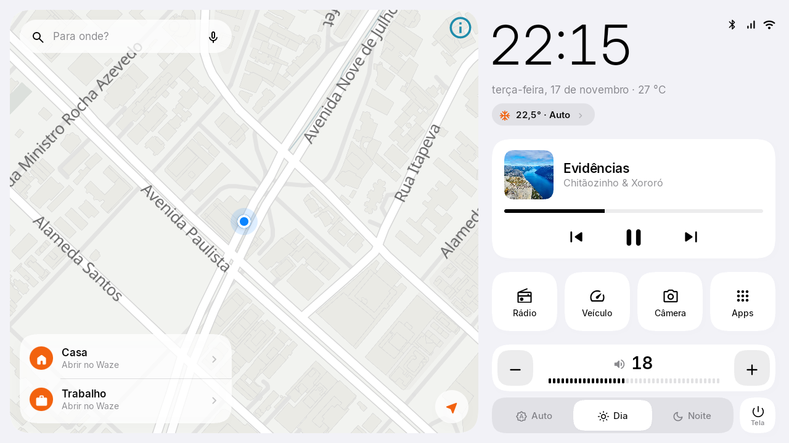

## Por que este projeto existe

Quase toda central multimídia Android de mercado vem com a mesma interface genérica: ícones do
Android puro, apps do fabricante sem padrão, fontes diferentes em cada tela. Funciona, mas não
parece fazer parte do carro.

O Nórdico nasceu de uma central específica (uma TorqueHammer VPL-1166: Unisoc UIS8581A,
Android 14, tela QLED de 9" em 1280×720) instalada num Honda Civic 2015. A meta era uma
interface com cara de ter saído da montadora: calma, legível com uma olhada rápida, com uma
única cor de destaque, conteúdo real e animações fluidas. A direção visual junta o layout com o
mapa em destaque dos sistemas escandinavos com o minimalismo da Apple.

**O Nórdico não troca a ROM.** É um app Android comum que se registra como tela inicial
(launcher). Tudo o que o firmware do fabricante oferece continua funcionando por baixo: câmera
de ré, comandos de volante, CarPlay/Android Auto, rádio. Dá para remover a qualquer momento e
não precisa de root.

## Prints

| Dia | Noite |
|---|---|
|  | 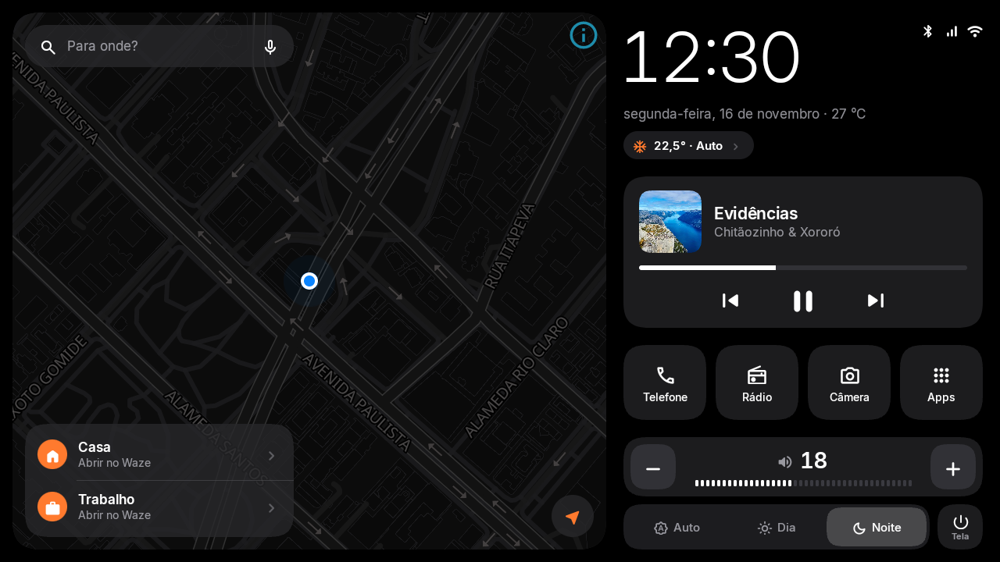 |
| 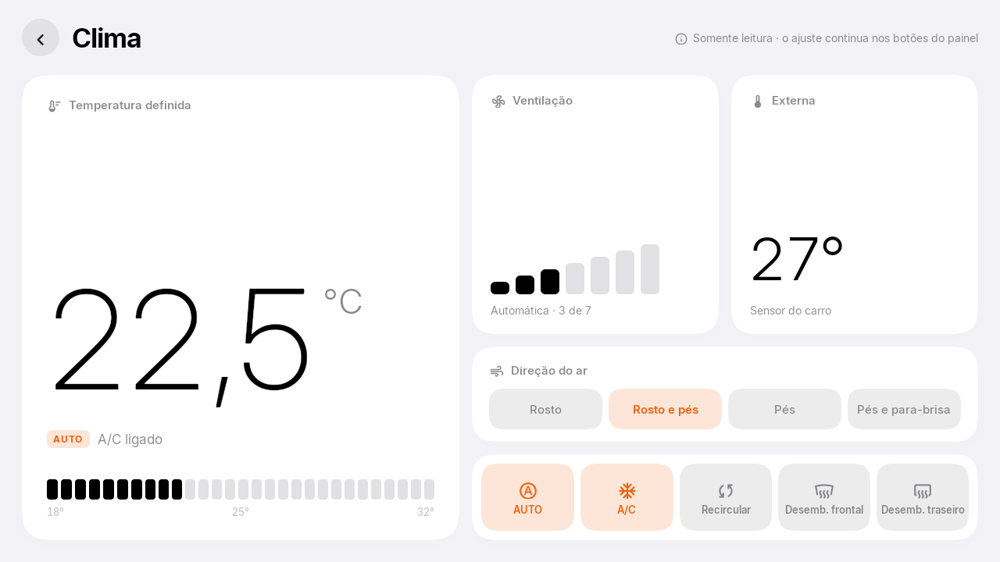 | 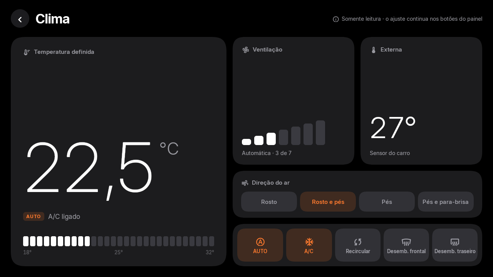 |

| Tocando agora | Gaveta de apps |
|---|---|
| 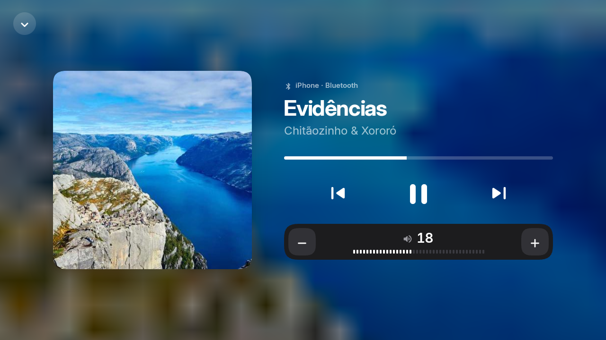 | 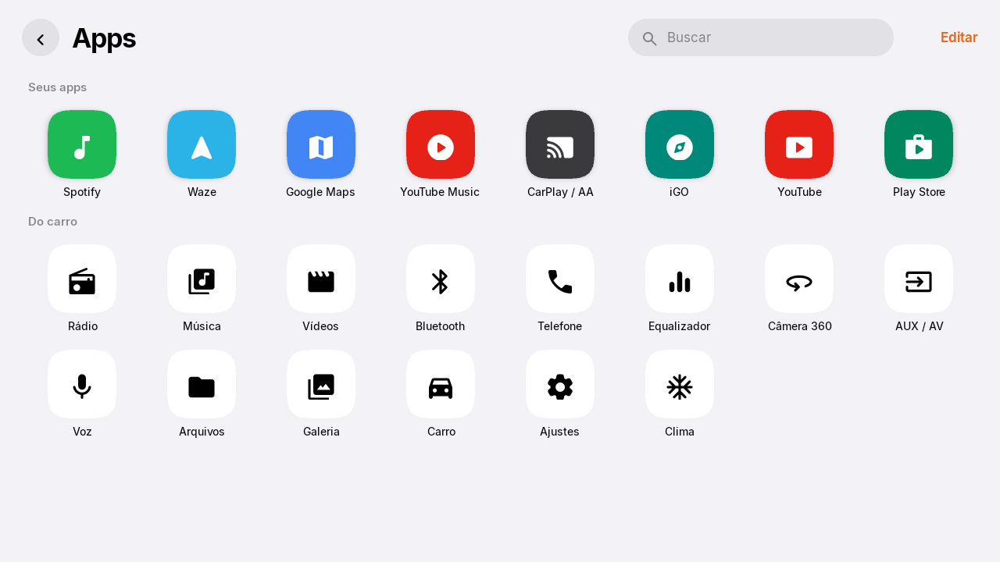 |
| 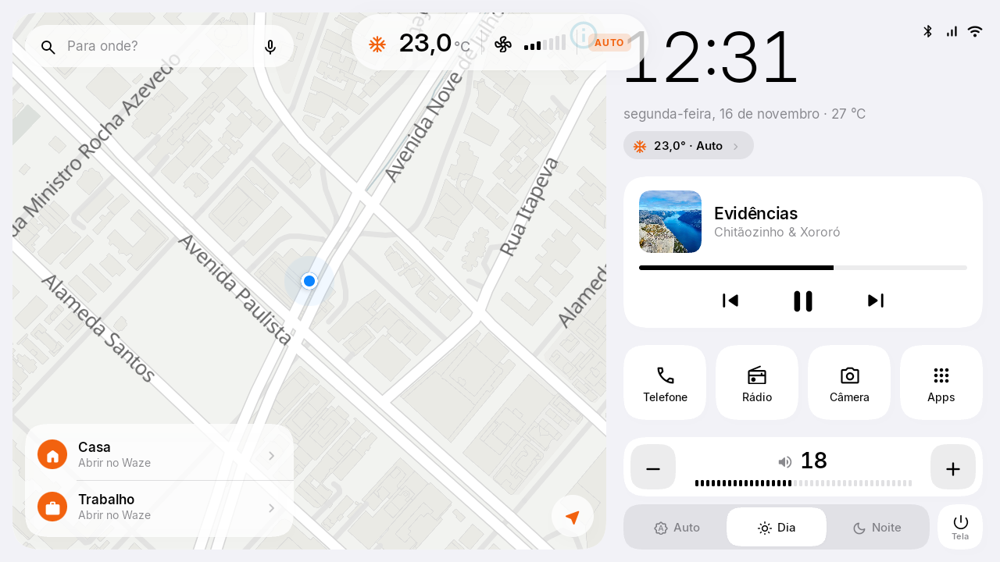 | 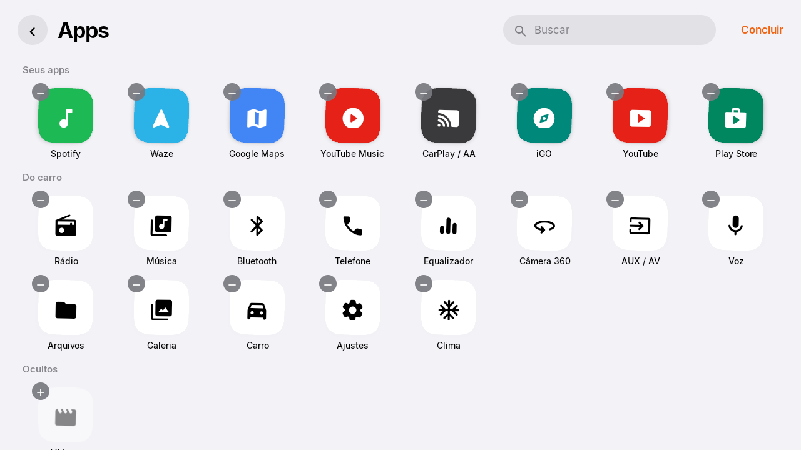 |

| Veículo | Rádio |
|---|---|
| 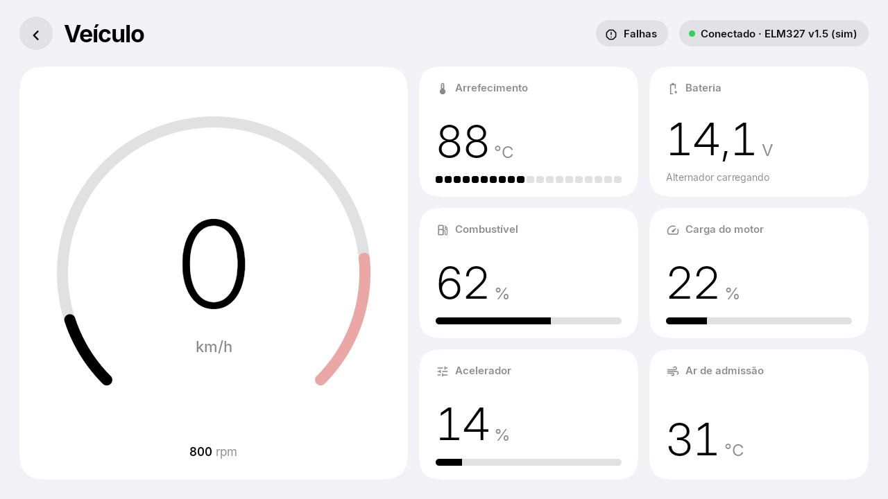 | 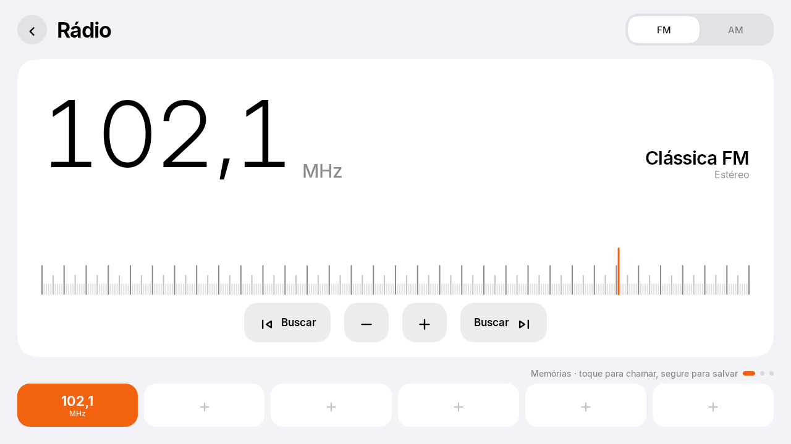 |
| 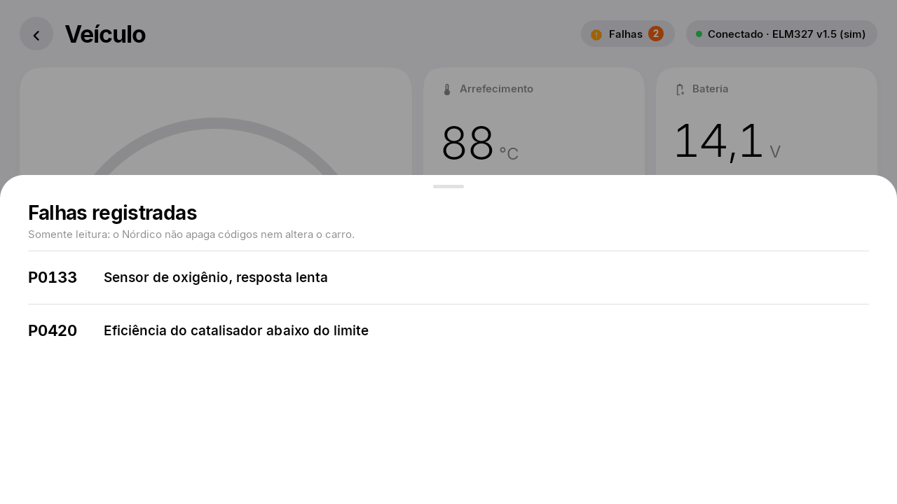 | 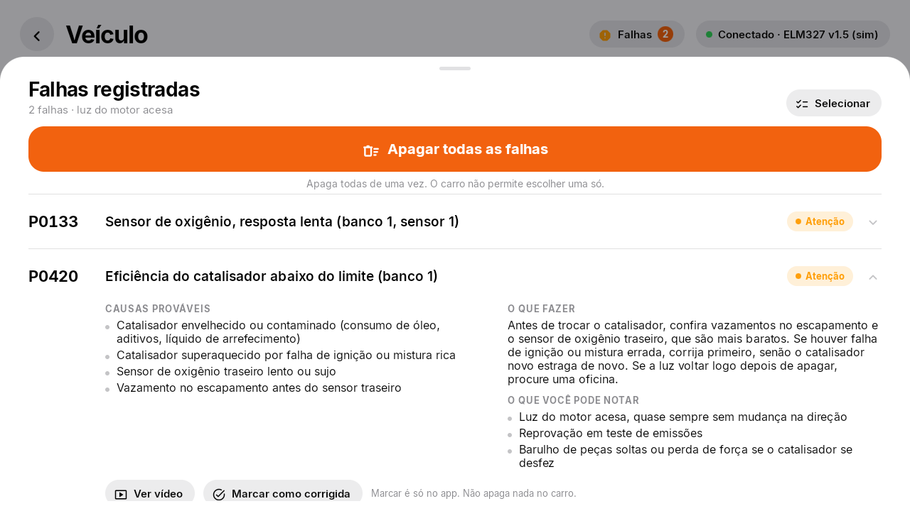 |
| 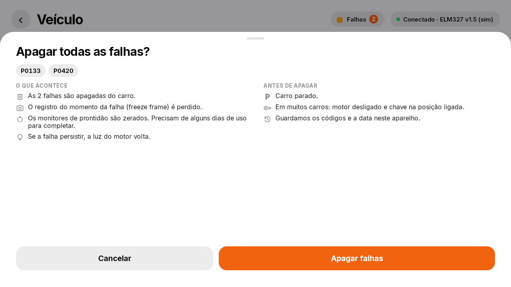 | |

Os protótipos HTML que definiram o design ficam em [`docs/prototipos/`](docs/prototipos) e
abrem direto no navegador.

## Funcionalidades

**Início**
- Mapa vetorial ao vivo (MapLibre + OpenFreeMap) com o ponto da sua posição. Os estilos de dia e de noite acompanham o tema.
- "Para onde?" abre o seu app de navegação. Os atalhos Casa e Trabalho abrem os favoritos salvos no Waze.
- Relógio grande, data por extenso, temperatura externa e um chip com o estado do ar.
- Card de música para qualquer app que publique sessão de mídia (Spotify, áudio Bluetooth, YouTube Music, navegadores…).
- Painel de volume com botões −/+ (segurar repete), régua segmentada e mudo com um toque no número.
- Modo da tela: Auto (segue o farol quando o carro informa; senão, das 18h às 6h), Dia ou Noite.
- Botão para desligar a tela, que deixa só um relógio fraco.

**Veículo (OBD-II)**
- Velocidade com arco de rotação, temperatura do motor, tensão da bateria, combustível, carga, acelerador e ar de admissão, lidos de um adaptador ELM327 por Bluetooth.
- Códigos de falha armazenados com selo de contagem. Cada código tem título, gravidade, causas prováveis, o que fazer e link de vídeo, de um catálogo offline com ~9.600 códigos (cerca de 100 escritos por completo em português, o resto com título, crescendo em lotes).
- **Apagar falhas**: "Apagar todas as falhas" envia o comando padrão do OBD-II (modo 04). É a única escrita que o app faz, e com proteções: só com o carro parado e conectado, depois de uma confirmação que explica os efeitos, sem reenvio automático, e só diz "apagado" depois de reler os códigos.
- "Marcar como corrigida" (uma ou várias) é uma anotação no app. Não mexe no carro: o padrão OBD-II não apaga um código só, apenas todos.
- Alertas de temperatura alta e tensão anormal da bateria, em um aviso sobre qualquer tela. Tocar nele abre o Veículo.
- Lê só com o app visível, espera mais a cada falha e reconecta sozinho.

**Rádio**
- FM e AM com escala arrastável, botões de buscar e passo, e 18 memórias FM / 12 AM (toque para sintonizar, segure para salvar).
- Na central real mostra o cartão "Rádio do fabricante" até a integração do sintonizador.

**Tocando agora**
- Barra de progresso arrastável com tempo decorrido e restante, e aleatório, repetir e curtir quando o app de música oferece.
- O card cresce até a tela cheia com transição compartilhada, e a capa do álbum "voa" até o lugar.
- O fundo desfocado sai da própria capa, sem custo de GPU: ela é reduzida para 32 px e esticada.

**Clima (somente leitura)**
- Temperatura definida, régua de 29 passos colorida conforme a temperatura, ventilação, direção do ar e os estados de AUTO, A/C, recirculação e desembaçadores.
- O aviso do ar aparece em qualquer tela quando os botões físicos mudam.

**Gaveta de apps**
- Seções "Seus apps" e "Do carro", com busca que ignora acentos.
- Todos os ícones usam o mesmo formato squircle.
- O modo de edição (toque longo ou "Editar") faz os ícones tremerem; os apps ocultos vão para a seção "Ocultos", com animação, e a escolha fica salva.

**Sistema**
- Aviso de volume para mudanças externas (volante ou teclas físicas), nunca para os botões da tela.
- O layout é desenhado numa tela lógica fixa de 1280×720 dp e fica idêntico em 160 ou 240 dpi.
- Tela cheia imersiva. A tecla Home sempre volta para o Início.

## Como funciona

```
┌─────────────────────────── Nórdico (app de tela inicial) ────────────────────────┐
│  feature/*  telas em Compose: início, mapa, tocando agora, clima, apps, avisos    │
│  navigation/  estado de tela + transições compartilhadas                         │
│  designsystem/  tokens, Inter, Material Symbols, squircle, animação com mola      │
│  data/*  uma interface por fonte: mídia, apps, áudio, veículo, status, local      │
└───────────────┬───────────────────────────────────────────────┬──────────────────┘
        flavor `sim`                                     flavor `device`
   dados simulados + painel de testes            APIs reais do Android (MediaSession,
   (roda em qualquer emulador)                    LauncherApps, AudioManager,
                                                  LocationManager, ConnectivityManager)
```

- **Duas variantes de build.** O `sim` roda em qualquer lugar com mídia, ar, farol e comandos de volante simulados, mais um painel de testes (toque longo no relógio). O `device` usa as APIs reais do Android. Cada variante tem o seu `AppContainer`, o único lugar onde as interfaces são ligadas às implementações (injeção manual, sem Hilt).
- **O hardware fica atrás de interfaces.** Ar, farol e temperatura externa vêm da caixa CAN do carro, então no `device` o `VehicleRepository` devolve `null` até a integração com a central existir (veja o roteiro). A interface esconde o que o carro não informa.
- **A lógica pura fica fora da interface** e é coberta por testes JVM: escala de volume, regras do painel do ar, resolução de dia/noite, formatação, seções de apps, tempos dos avisos e posição da música.

## Stack

| Área | Escolha |
|---|---|
| Linguagem | Kotlin 2.4 |
| Interface | Jetpack Compose (foundation, ui, animation; **sem Material 3**, design system próprio) |
| Build | AGP 9.5, Gradle 9.9 (wrapper), version catalog |
| Mapa | MapLibre Android 13.7 + estilos OpenFreeMap (sem chave de API) |
| Persistência | DataStore Preferences |
| Tipografia | Inter / Inter Display (embutidas) |
| Ícones | Fonte variável Material Symbols Rounded, desenhada por ligadura |
| Testes | JUnit 4, kotlinx-coroutines-test |
| SDK mínimo / alvo | 34 / 34 (Android 14, o mesmo da central) |

## Estrutura do projeto

```
app/src/
├── main/java/app/nordico/launcher/
│   ├── MainActivity.kt          activity de tela inicial, densidade lógica, modo imersivo
│   ├── designsystem/            tokens, tema, tipografia, ícones, formas, componentes
│   ├── navigation/              telas, view model do app, casca, transições
│   ├── feature/                 home, map, nowplaying, climate, apps, hud
│   └── data/                    contratos e regras puras por fonte de dados
├── sim/                         repositórios simulados + painel de testes
├── device/                      implementações reais do Android
├── test/                        testes JVM
└── testSim/                     testes das fontes simuladas
docs/
├── specs/                       spec de design
├── plans/                       plano de implementação
├── prototipos/                  protótipos HTML interativos
└── screenshots/
```

## Como rodar

### Requisitos
- JDK 17 ou mais novo
- Android SDK com a plataforma `android-37` e as ferramentas de linha de comando
- Uma imagem de emulador Android 14 (API 34) ou uma central multimídia

### Build e testes

```bash
git clone https://github.com/Peixotim/nordico-launcher.git
cd nordico-launcher
echo "sdk.dir=/caminho/para/Android/Sdk" > local.properties

./gradlew testSimDebugUnitTest     # testes JVM
./gradlew assembleSimDebug         # build do emulador (dados simulados)
./gradlew assembleDeviceDebug      # build da central (APIs reais)
```

### Emulador que imita a central

```bash
sdkmanager "system-images;android-34;google_apis;x86_64"
avdmanager create avd -n Central9 -k "system-images;android-34;google_apis;x86_64" -d pixel_c
```

Depois ajuste em `~/.android/avd/Central9.avd/config.ini`:

```
hw.lcd.width=1280
hw.lcd.height=720
hw.lcd.density=160
hw.initialOrientation=landscape
showDeviceFrame=no
```

### Instalar e definir como tela inicial

```bash
emulator -avd Central9 &
./gradlew installSimDebug
adb shell cmd role add-role-holder android.app.role.HOME app.nordico.launcher.sim
adb shell input keyevent KEYCODE_HOME
```

No build `sim`, **segure o relógio** para abrir o painel de simulação: botões do ar
(temperatura, ventilação, AUTO, A/C, direção, recirculação, desembaçadores), volume do volante,
farol ligado/desligado/sem sinal e "sem dados do ar".

### Numa central de verdade (build `device`)

```bash
./gradlew installDeviceDebug
adb shell cmd role add-role-holder android.app.role.HOME app.nordico.launcher
```

Na primeira execução o app pede a localização. A música precisa de acesso às notificações:
toque em "Permitir acesso à música" na tela inicial ou rode
`adb shell cmd notification allow_listener app.nordico.launcher/app.nordico.launcher.device.MediaListenerService`.

## Roteiro

**Fase 1: concluída**
- Design system, tela inicial, tocando agora, clima, gaveta de apps, avisos, fontes de dados simuladas e reais.

**Fase 1.5: sem precisar da central**
- [ ] Avisos desenhados por cima de outros apps (volume e ar em cima do Waze ou do Spotify).
- [ ] Navegação curva a curva no card do mapa, lida das notificações do Waze e do Google Maps.
- [ ] Acabamento: mapa noturno mais claro, indicador 4G/5G independente do Wi-Fi, busca da gaveta zerada ao sair.

**Fase 2: telas de sistema**
- [x] Telas de veículo (OBD-II) e rádio, com dados simulados e um emulador ELM327 para testes (`-PobdTcp=10.0.2.2:35000`).
- [ ] Rádio por cima do rádio do fabricante (precisa da central).
- [ ] Ajustes do Nórdico (cor de destaque, app de navegação, app de música).

**Fase 3: integração com a central**
- [ ] Identificar a plataforma do fabricante e mapear os ícones dos apps dele.
- [ ] Ar, temperatura externa, farol e portas vindos da caixa CAN. Firmwares baseados em QF também aceitam comandos do ar, o que permitiria controlar o ar pela tela sem hardware extra.
- [ ] Volume do MCU do fabricante (o volume do amplificador, que é o que o volante controla).
- [ ] Medições de desempenho no SoC real.

## Limitações conhecidas

- Os dados do ar são simulados até existir a integração com a central. O build `device` esconde a interface do ar.
- A câmera de ré fica com o firmware do fabricante de propósito: é item de segurança e precisa aparecer na hora, até durante o boot.
- Um launcher comum não consegue embutir apps de navegação de terceiros (só apps de sistema podem hospedar janelas de outros apps), então o "Para onde?" abre o app em tela cheia.
- Trocar o estilo do mapa entre dia e noite recarrega pela internet (cerca de 1 a 3 s).

## Como contribuir

Issues e pull requests são bem-vindos. Por favor:
- Use [Conventional Commits](https://www.conventionalcommits.org/) (`feat(map): …`, `fix(audio): …`).
- Mantenha a lógica pura fora dos composables e cubra com um teste JVM.
- Rode `./gradlew testSimDebugUnitTest assembleDeviceDebug` antes de abrir o PR.
- Para mudanças de interface, anexe prints de antes e depois, nos modos dia e noite.

## Agradecimentos

- [open-car-project](https://github.com/maldos23/open-car-project): launcher automotivo de código aberto cuja pesquisa sobre firmwares de centrais é a principal referência para a fase 3.
- Comunidades [MapLibre](https://maplibre.org/), [OpenFreeMap](https://openfreemap.org/) e [OpenStreetMap](https://www.openstreetmap.org/copyright).
- [Inter](https://rsms.me/inter/), de Rasmus Andersson, e [Material Symbols](https://fonts.google.com/icons), do Google.

## Aviso

O Nórdico é um projeto independente, sem vínculo ou endosso de Honda, TorqueHammer, Apple,
Volvo, Polestar ou qualquer outra empresa citada aqui; as marcas pertencem aos seus donos. Não
use a central de um jeito que tire sua atenção da direção. Use por sua conta e risco.

## Licença

[MIT](LICENSE). Os recursos de terceiros embutidos mantêm as próprias licenças: Inter (SIL Open
Font License 1.1) e Material Symbols (Apache 2.0). Dados de mapa © colaboradores do
OpenStreetMap (ODbL).
